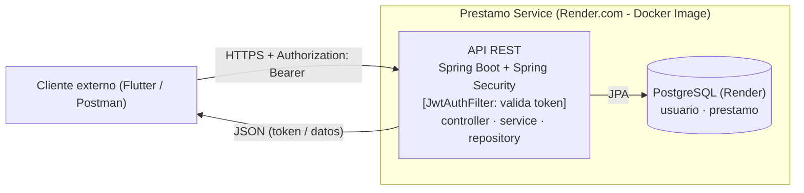

# Especificación — Parte 1: API REST PrestaControl (Spring Boot + JWT + Render vía Docker Hub)

> **Contexto de ejecución:** Esta es la **Sesión 1 de 2** (ejecutada en la PC 1). Construye **únicamente** el proyecto backend en Spring Boot (`prestamoservice`), su `Dockerfile`, la colección de Postman y la guía `DEPLOY_RENDER.md` usando **Docker Hub** (sin GitHub). No generes código Flutter.

---

## 1. Datos del Proyecto y Arquitectura

- **GROUP ID:** `com.fernandez_terrones`
- **Artifact:** `prestamoservice`
- **Package base:** `com.fernandez_terrones.prestamoservice`
- **Java / Framework:** Java 17+, Spring Boot 3.x, Maven.
- **Dependencias:** Spring Web, Spring Security, Spring Data JPA, Validation, driver de **PostgreSQL** (`org.postgresql:postgresql`) y librería JWT (`io.jsonwebtoken:jjwt-api`, `jjwt-impl`, `jjwt-jackson`).
- **Capas requeridas:** `entity`, `repository`, `dto`, `service`, `controller`, `security` y `config`.



---

## 2. Modelo de Datos (PostgreSQL)

Un prestamista (`usuario`) otorga muchos préstamos (`prestamo`).

### Tabla `usuario`
| Nombre | Tipo de dato | Propiedad |
| :--- | :--- | :--- |
| `id` | bigint | Primary Key, autoincrement |
| `nombre` | varchar(100) | not null |
| `email` | varchar(120) | not null, unique |
| `password` | varchar(100) | not null (cifrada con BCrypt, nunca en texto plano) |
| `rol` | varchar(20) | not null, default `USER` |

### Tabla `prestamo`
| Nombre | Tipo de dato | Propiedad |
| :--- | :--- | :--- |
| `id` | bigint | Primary Key, autoincrement |
| `cliente` | varchar(100) | not null (persona que recibe el dinero) |
| `dni` | varchar(8) | not null (exactamente 8 dígitos) |
| `monto` | decimal(10,2) | not null, mayor a 0 |
| `interes` | decimal(5,2) | not null (porcentaje, >= 0) |
| `fecha_prestamo` | date | not null (la asigna automáticamente la API con `LocalDate.now()`) |
| `fecha_vencimiento` | date | not null |
| `pagado` | boolean | not null, default `false` |
| `usuario_id` | bigint | not null, Foreign Key a `usuario(id)` |

---

## 3. Endpoints y Contrato JSON Estricto

Los endpoints de `/auth` son públicos; los de `/prestamos` requieren cabecera `Authorization: Bearer <token>`.

| Servicio | Tarea | Método | Endpoint | Acceso | Descripción |
| :--- | :--- | :--- | :--- | :--- | :--- |
| Auth | Registrar prestamista | POST | `/auth/register` | Público | Crea cuenta y devuelve token JWT. |
| Auth | Iniciar sesión | POST | `/auth/login` | Público | Valida credenciales y devuelve token JWT. |
| Préstamo | Listar préstamos | GET | `/prestamos` | Token | Lista préstamos del prestamista autenticado, incluido `totalCobrar`. |
| Préstamo | Obtener préstamo | GET | `/prestamos/{id}` | Token | Devuelve un préstamo por ID si pertenece al prestamista del token. |
| Préstamo | Registrar préstamo | POST | `/prestamos` | Token | Registra dinero prestado a un cliente. |
| Préstamo | Actualizar préstamo | PUT | `/prestamos/{id}` | Token | Modifica el préstamo o lo marca como pagado (`pagado: true`). |
| Préstamo | Eliminar préstamo | DELETE | `/prestamos/{id}` | Token | Anula un préstamo registrado por error. |
| Préstamo | Resumen de cartera *(extra)* | GET | `/prestamos/resumen` | Token | Devuelve `capitalPrestado`, `totalPorCobrar` y `gananciaEsperada` del prestamista. |

### Estructura exacta de DTOs (Request / Response)

- **POST `/auth/register` (Request):**
  ```json
  { "nombre": "Juan Perez", "email": "juan@mail.com", "password": "Password123" }
  ```
- **POST `/auth/login` (Request):**
  ```json
  { "email": "juan@mail.com", "password": "Password123" }
  ```
- **Auth Response (`200 OK`):**
  ```json
  { "token": "eyJhbGciOiJIUzI1NiJ9..." }
  ```
- **POST `/prestamos` y PUT `/prestamos/{id}` (Request):**
  ```json
  {
    "cliente": "Carlos Gomez",
    "dni": "72458910",
    "monto": 1000.00,
    "interes": 15.00,
    "fechaVencimiento": "2026-12-25",
    "pagado": false
  }
  ```
- **Prestamo Response (`200 OK` / `201 Created`):**
  ```json
  {
    "id": 1,
    "cliente": "Carlos Gomez",
    "dni": "72458910",
    "monto": 1000.00,
    "interes": 15.00,
    "totalCobrar": 1150.00,
    "fechaPrestamo": "2026-11-25",
    "fechaVencimiento": "2026-12-25",
    "pagado": false
  }
  ```
  *(Nota: `totalCobrar` se calcula en backend como `monto + (monto * interes / 100)`).*
- **GET `/prestamos/resumen` (Response `200 OK`):**
  ```json
  {
    "capitalPrestado": 1000.00,
    "totalPorCobrar": 1150.00,
    "gananciaEsperada": 150.00
  }
  ```

---

## 4. Requisitos de Seguridad

- Contraseñas cifradas con `BCryptPasswordEncoder`.
- Token JWT firmado con `JWT_SECRET`, con fecha de expiración (`JWT_EXPIRATION`) y el `email` del prestamista como `subject`.
- API **stateless** (`SessionCreationPolicy.STATELESS`).
- **CORS habilitado** globalmente en `SecurityConfig` permitiendo orígenes `*`, métodos `GET, POST, PUT, DELETE, OPTIONS` y cabeceras `Authorization, Content-Type`.
- Si no se envía token, o si está alterado o vencido, responder **401 Unauthorized** mediante un `AuthenticationEntryPoint` personalizado.
- El prestamista se obtiene **exclusivamente desde el token** (`SecurityContextHolder`), nunca desde parámetros o cuerpo de petición. Si intenta acceder/editar/eliminar un préstamo de otro usuario, devolver `404` o `403`.

---

## 5. Entregables de Despliegue y Documentación (Sin GitHub)

Además del código fuente en Java, genera en este repositorio:

1. **`src/main/resources/application.properties`:** Configurado 100% con variables de entorno (`PORT`, `DB_URL`, `DB_USERNAME`, `DB_PASSWORD`, `JWT_SECRET`, `JWT_EXPIRATION`) y `spring.jpa.hibernate.ddl-auto=update`.
2. **`Dockerfile` y `.dockerignore`:** Multi-etapa (Maven + Java 17 JRE Alpine) leyendo `-Dserver.port=${PORT:-8080}` para publicar la imagen en **Docker Hub** y ejecutarla en Render.com.
3. **`postman/PrestaControl.postman_collection.json`:** Colección con todos los endpoints, variables `{{base_url}}` y `{{token}}`, script post-respuesta en `login` y `register` para guardar el token automáticamente, y prueba sin token para verificar `401`.
4. **`DEPLOY_RENDER.md`:** Guía paso a paso con todos los datos reales del proyecto (`com.fernandez_terrones.prestamoservice`), comandos para compilar y subir la imagen a **Docker Hub** (`docker buildx build --platform linux/amd64 -t <usuario_dockerhub>/prestamoservice:latest --push .`), creación de PostgreSQL en Render, creación del Web Service en Render usando **"Deploy an existing image from a registry"** (`docker.io/<usuario_dockerhub>/prestamoservice:latest`), variables de entorno exactas y comandos `curl` de verificación.